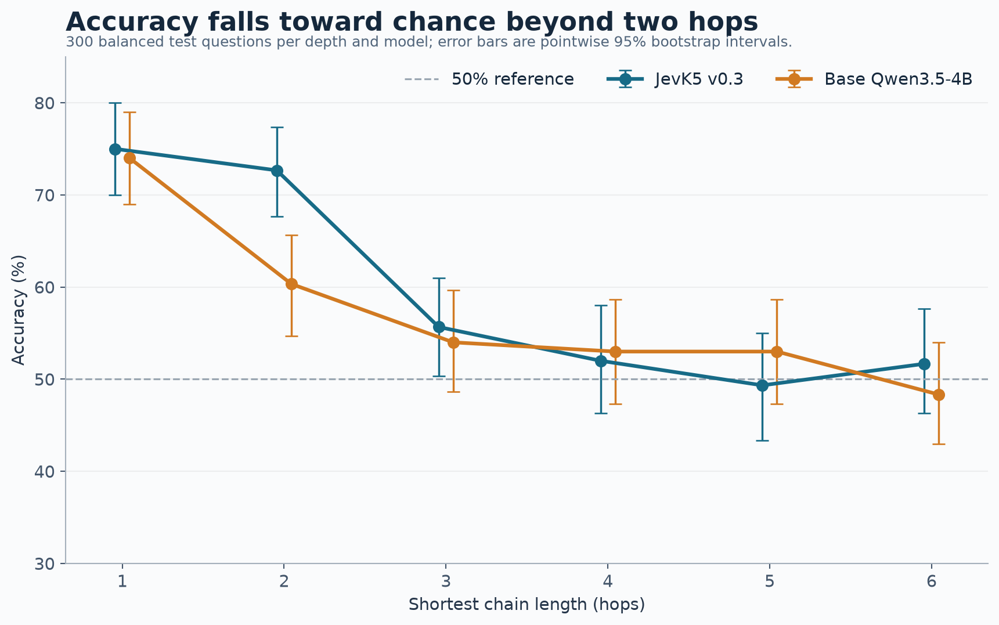
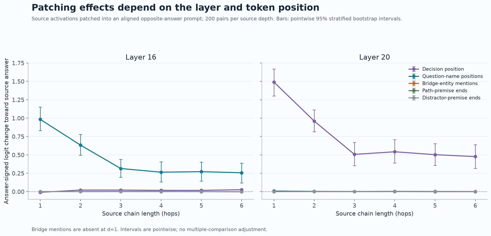

# JevK5 depth and composition study

A preliminary mechanistic-interpretability study of JevK5 v0.3, an open decision-tuned model based on Qwen3.5-4B, and its base-model comparison. We measure performance on synthetic transitive questions with one to six linked facts, then use activation patching to test whether selected internal states causally move answers between matched prompts.

## Completed follow-ups

The [Part I article](https://msaadasad.com/writing/looped-system-1-models) brings the completed behavioral and patching experiments together. Recurrence is the question for Part II; no recurrent model has been evaluated here.

- **Depth by context:** 9,600 evaluations, spanning depths 1 to 4 and 0/4/12/24 off-path premises in both checkpoints. Both models score 100% on clean one-hop lookup, versus 75% for JevK5 and 74% for Qwen with 24 off-path facts. Clean deeper chains expose an endpoint-role shortcut, so high reduced-context accuracy is not proof of multi-hop composition. [Report, paired contrasts and shortcut audit](reports/context-factorial/REPORT.md).
- **All 32 layers:** 48,640 primary patches across both checkpoints, five position groups where applicable, and a fresh 40-pair-per-depth cohort. Layer 12 gives the largest mean question-name effect at one and two hops in both models. At two hops the source-answer logit-margin changes are +0.825 for JevK5 and +0.328 for Qwen. These locate answer-sensitive states; they do not identify the composition mechanism. [Methods, effects and controls](reports/2026-10-18-all-layer-patching.md).
- **Checkpoint comparison:** in the original 25-premise two-hop task, JevK5 answers 218/300 correctly versus 181/300 for Qwen, a 12.3-percentage-point gap from the unrounded counts. It is an observed difference under this evaluation, not an isolated effect of training on relational composition.

## Original selected-layer study

On 300 balanced test questions per depth, both models are near 75% on one-hop questions and close to chance by three hops on a fixed 25-premise task. JevK5 scores 72.7% at two hops and Qwen3.5-4B scores 60.3%; the point estimates are close to chance at depths three through six.



In a 1,200-pair counterfactual patch study, layer-16 states at the two question-name positions shifted the answer toward the donor prompt at one and two hops. Layer-20 decision-position patches also shifted answers. Patching source-path bridge mentions or premise ends had little effect in the tested setup.



These results show a behavioral drop on this task and answer-sensitive internal states. They do not identify a complete multi-hop computation, establish a general reasoning-depth ceiling, or show that a recurrent architecture would help. The counterfactual pairs change four premises and can differ in hop distance; patch results are position- and layer-specific, and intervals are pointwise without a multiplicity correction.

The full report, including uncertainty intervals, methods, and interpretation, is [here](reports/2026-10-11-depth-composition-results.md).

## Earlier one-hop observations

On the same 300 one-hop questions, JevK5 scored 100% with the answer-giving fact alone, 99.3% with five premises, 92.7% with thirteen, and 75% with all 25 premises. Premise count, total context length, and relevant-fact position vary together, so this is evidence of context sensitivity, not an isolated context-length effect.

On 100 fresh one-hop questions with 25 premises, a layer-16 patch at both question-name positions raised accuracy from 71% to 87% when the donor contained the correct fact. A reversed-fact donor yielded 50%; an unrelated-fact donor yielded 72%. This suggests fact-sensitive information at those positions affects answers; it does not identify the underlying computation.

## Reproduction

The package contains task generation, prompt rendering, model loading, scoring, hooks, and evaluation utilities. `scripts/compose_patch.py` runs the streaming six-depth patch study; `scripts/run_depth_composition.sh` resumes the behavior curves and patch study in tmux. `scripts/plot_depth_composition.py` renders charts from local aggregate run summaries.

Run data, datasets, activations, model weights, and local environment files are intentionally excluded. Reproducing the run requires the 25-premise test dataset and locally available pinned model revisions; GPU workflows are resource intensive. The committed report and figures contain aggregate results only. The local plotting script expects saved summaries under `runs/`.

## Scope

Results cover these model revisions and one synthetic task family. They do not establish what closed Jev models do internally, prove a symbolic intermediate representation, or support claims about recurrence.

## Reproducing the follow-ups

Install the package with its development and plotting extras in a Python 3.11+ environment. The completed runs used the pinned revisions listed in the reports and already-cached model/tokenizer files. The shell launchers target Apple MPS, run in tmux, and hold a continuous macOS caffeinate assertion. tmux alone does not prevent system sleep. For another device, use the Python CLIs directly with their device option.

Generate the seed-0 E1 cohort before the context study:

```sh
python -m jevprobe.data.make_data --out data/e1 --seed 0 --test-per-d 300 --pairs-per-d 0
python scripts/make_context_factorial.py
# After caching both pinned model revisions, on an MPS machine:
bash scripts/run_context_factorial.sh
python scripts/report_context_factorial.py
```

The layer study prepares its own fresh cohort. After caching the pinned tokenizers and model revisions:

```sh
bash scripts/run_layer_followup.sh
# Only after both first-screen runs finish:
bash scripts/run_remaining_layers.sh
```

The second launcher validates the original results, evaluates the remaining 24 layers, then combines coverage of all 32. Resume the same launcher after interruption. Preparers and runners reject changed frozen provenance. Generated plans/results remain local and ignored by Git. The public source does not include the model weights or prompt-level outputs.

Run the lightweight checks with `python -m pytest`. Tests marked `model` are excluded by default and require explicit opt-in; they are not part of the publication checks.
