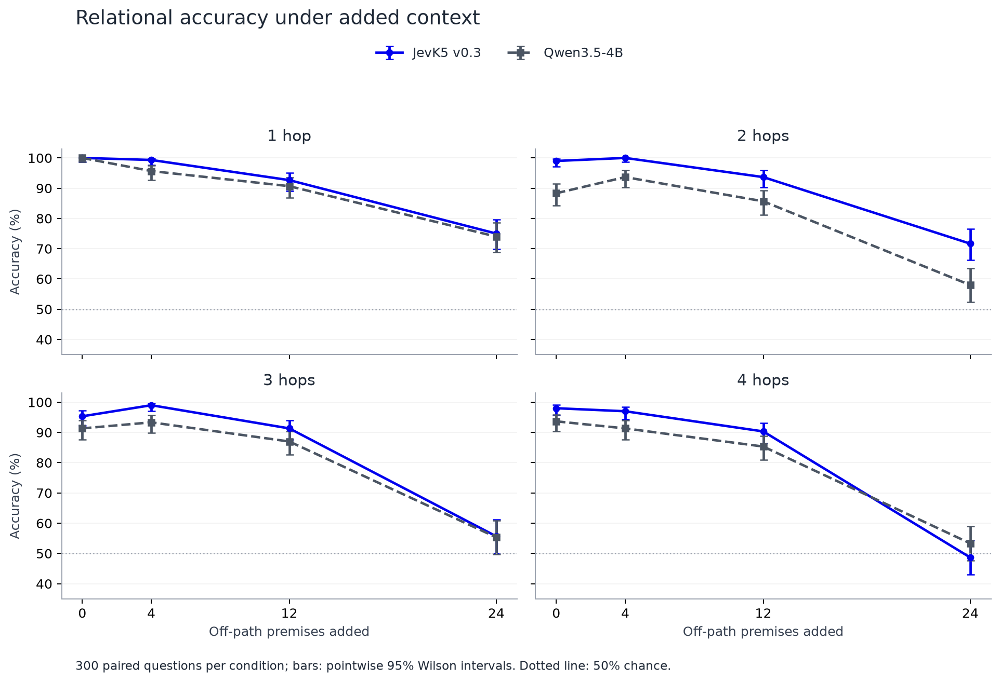
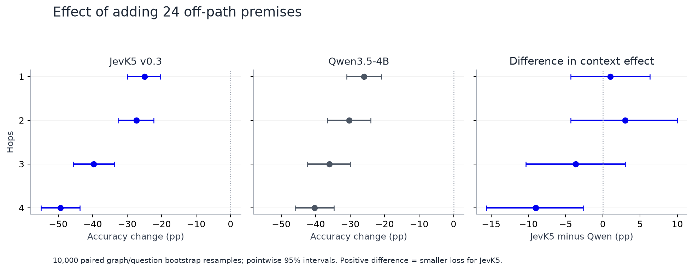

# Paired depth × context experiment

Both models completed 4,800 evaluations: 300 balanced questions at each of four depths and four context doses. Both checkpoints received identical prompts. All comparisons below use the frozen cohort.

## Main observations

- Both models scored **100%** on clean one-hop questions. With 24 off-path facts, accuracy fell to **75.0%** for JevK5 and **74.0%** for Qwen. The relationship is explicitly stated in these one-hop prompts.
- At four hops, **JevK5 v0.3** scored **98.0%** with only path facts and **48.7%** with 24 off-path facts added.
- At four hops, **Qwen3.5-4B** scored **93.7%** with only path facts and **53.3%** with 24 off-path facts added.
- These are context-dependent behavioral differences. The clean chains expose a local endpoint cue, so high clean accuracy does not establish a composition mechanism; see the structural audit below.

## Accuracy

| Model | Hops | 0 off-path facts | 4 | 12 | 24 |
|---|---:|---:|---:|---:|---:|
| JevK5 v0.3 | 1 | 100.0% | 99.3% | 92.7% | 75.0% |
| JevK5 v0.3 | 2 | 99.0% | 100.0% | 93.7% | 71.7% |
| JevK5 v0.3 | 3 | 95.3% | 99.0% | 91.3% | 55.7% |
| JevK5 v0.3 | 4 | 98.0% | 97.0% | 90.3% | 48.7% |
| Qwen3.5-4B | 1 | 100.0% | 95.7% | 90.7% | 74.0% |
| Qwen3.5-4B | 2 | 88.3% | 93.7% | 85.7% | 58.0% |
| Qwen3.5-4B | 3 | 91.3% | 93.3% | 87.0% | 55.3% |
| Qwen3.5-4B | 4 | 93.7% | 91.3% | 85.3% | 53.3% |



## Primary paired contrasts

Change in accuracy from 0 to 24 off-path facts, in percentage points. Negative values mean accuracy fell.

| Model | Hops | Change (pp) | Paired 95% interval |
|---|---:|---:|---:|
| JevK5 v0.3 | 1 | -25.0 | [-30.0, -20.3] |
| Qwen3.5-4B | 1 | -26.0 | [-31.0, -21.0] |
| JevK5 v0.3 | 2 | -27.3 | [-32.7, -22.3] |
| Qwen3.5-4B | 2 | -30.3 | [-36.7, -24.0] |
| JevK5 v0.3 | 3 | -39.7 | [-45.7, -33.7] |
| Qwen3.5-4B | 3 | -36.0 | [-42.3, -30.0] |
| JevK5 v0.3 | 4 | -49.3 | [-55.0, -43.7] |
| Qwen3.5-4B | 4 | -40.3 | [-46.0, -34.7] |

Positive between-model differences below mean JevK5 lost less accuracy under added context; negative differences mean it lost more.

| Hops | JevK5 context effect − Qwen context effect (pp) | Paired 95% interval |
|---:|---:|---:|
| 1 | +1.0 | [-4.3, +6.3] |
| 2 | +3.0 | [-4.3, +10.0] |
| 3 | -3.7 | [-10.3, +3.0] |
| 4 | -9.0 | [-15.7, -2.7] |



## Interpretation and a structural limitation

The contrasts measure sensitivity to added off-path facts under these prompts. They do not isolate semantic interference from token length, evidence position, or changes in available structural cues. This is factual context interference, not an adversarial instruction-poisoning experiment. The dose response is not strictly monotonic: some four-fact conditions improve descriptively over the zero-fact baseline.

A post-hoc audit checks an important shortcut: if a queried entity appears only on the greater side or only on the lesser side of its premises, its endpoint role can reveal the answer in this generated chain family. With no off-path facts, the queried entities are endpoints of the presented path. This local cue does not require composing the whole path. The audit uses parsed premise directions and abstains when neither queried entity has an unambiguous role; it does not establish that either model uses the cue.

For example, in `A > B, B > C`, A appears only as greater and C only as lesser. Adding `X > A` and `C > Y` removes those local cues while preserving the answer to A > C. The experiment therefore changes available shortcuts along with context length and fact position.

| Hops | 0-fact cue coverage | 4-fact coverage | 12-fact coverage | 24-fact coverage |
|---:|---:|---:|---:|---:|
| 1 | 100.0% | 98.7% | 71.0% | 0.0% |
| 2 | 100.0% | 98.7% | 77.3% | 0.0% |
| 3 | 100.0% | 97.3% | 78.3% | 0.0% |
| 4 | 100.0% | 97.7% | 77.0% | 0.0% |

Consequently, high clean-context accuracy does not establish a multi-hop composition mechanism or a pure measure of reasoning depth. The original distracted-task failures also cannot establish a fixed reasoning-depth ceiling. Checkpoint differences cannot by themselves identify which training change caused them.

## Methods and validation

- 4 depths × 4 off-path-fact doses × 300 items × 2 models = 9,600 evaluations.
- Same base question and nested off-path-fact sets across context doses; same prompts across models.
- Total premises = hop depth + off-path dose. The 24-fact condition therefore contains 25–28 premises; only its one-hop cell exactly reproduces the original 25-premise setup.
- Each depth contains 300 distinct source graphs. Graph/base question is the resampling unit; context and checkpoint comparisons preserve pairing.
- Answers are forced-choice A/B decisions from the sign of the final-position logit difference, using the same prompt/readout convention for both checkpoints. No reasoning tokens are generated.
- Accuracy intervals are Wilson intervals. Paired contrasts use 10,000 bootstrap resamples. All intervals are pointwise; no multiple-comparison correction was applied.
- Off-path facts include main-chain edges, a separate distractor chain, and disconnected fillers where needed. Counts and positions are retained in the layout manifest.
- The endpoint-cue audit was added after inspecting the completed JevK5 results while Qwen evaluation was still in progress; it is exploratory and does not alter the planned primary contrasts.
- Final manifest, prompt hashes and complete unique item coverage were checked by the paired summarizer.

Qwen A/B diagnostic: **100/100** on the preselected balanced clean one-hop subset. This diagnoses the combined prompt/readout/direct-retrieval setup rather than isolating answer-format following.

Pinned revisions:

- JevK5 v0.3: `c4f7fdb3aeab5582336406e78d3bef11bf98833d`
- Qwen3.5-4B: `851bf6e806efd8d0a36b00ddf55e13ccb7b8cd0a`

Context dataset SHA-256: `8532f741b1705ef019234fba3525bb92fb6c1ae0f2e0e8c9c11a435bd7bb3325`.
Source E1 dataset SHA-256: `d9be0897b660ac87126be65e2505291666eac4c32786cbfc2de798cc1b14de3b`. Context sampling seed: `0`.

Reproduce the completed analysis and figures:

```sh
.venv/bin/python scripts/summarize_context_factorial.py
.venv/bin/python scripts/report_context_factorial.py
```

## Project status

The depth × context behavioral follow-up is complete. The subsequent all-32-layer localization screen is also complete; see [its report](../2026-10-18-all-layer-patching.md). Independent confirmation and controlled premise-composition tests remain possible follow-ups, not completed findings. No recurrence has been implemented or validated by this experiment.
